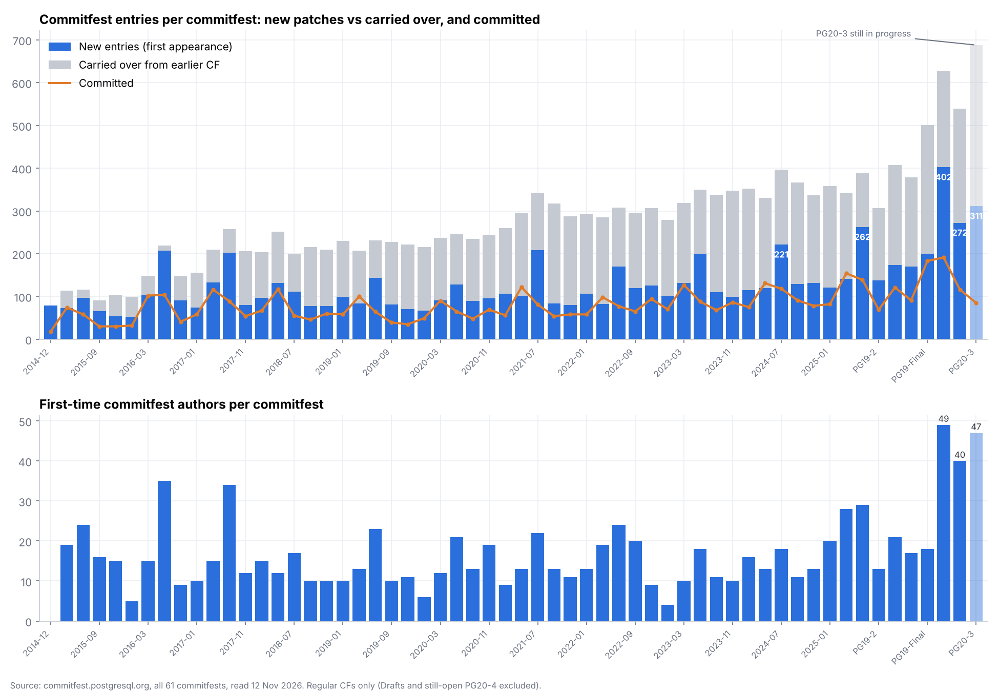
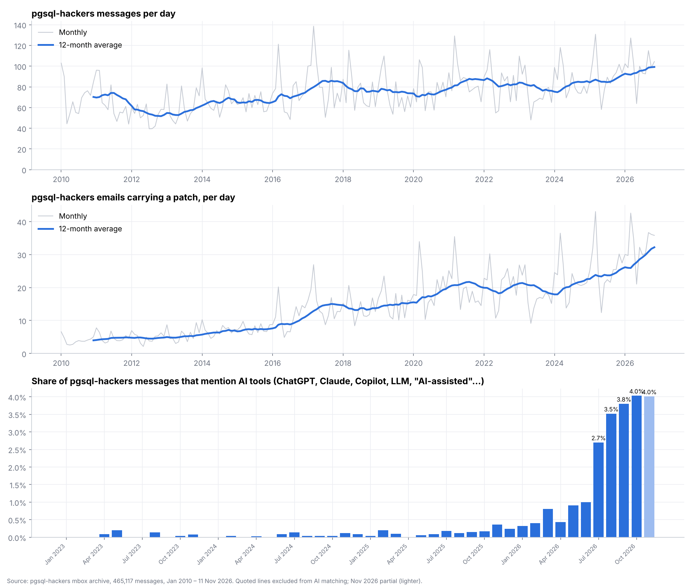

# Commitfest and pgsql-hackers growth stats

Snapshot taken 12 Nov 2026. Question: are commitfests and pgsql-hackers
growing, and does the timing line up with AI coding tools?




## Key numbers

| Jul + Sep commitfests | New entries | First-time authors | Committed |
|---|---|---|---|
| 2024 (2024-07, 2024-09) | 350 | 29 | 209 |
| 2025 (PG19-1, PG19-2) | 399 | 42 | 208 |
| 2026 (PG20-1, PG20-2) | 674 (+93%) | 89 (+207%) | 307 (+47%) |

pgsql-hackers, 2026 to date vs 2025: messages per day 99.4 vs 91.2 (+9%),
patch emails per day 32.4 vs 25.7 (+26%). Messages mentioning AI tools went
from 0.15% of mail in 2025 to 3.8% in Aug–Oct 2026.

## Data

- `data/commitfests.csv`: one row per commitfest (2014-12 to PG20-4) with
  total, new, carried over, committed, withdrawn and author counts.
- `data/cf_patches.tsv`: every patch row on every commitfest page, as read
  from commitfest.postgresql.org.
- `data/hackers_monthly.csv`, `data/hackers_yearly.csv`: pgsql-hackers mail
  counts from Jan 2010 to 11 Nov 2026 (465,117 messages). Nov 2026 is
  partial, so compare per-day rates.
- `data/hackers_ai_terms.csv`: AI terms matched per year.

## Definitions

- **New entry**: a patch ID's first appearance in any commitfest.
- **First-time author**: a commitfest username listed as author for the
  first time.
- **Thread start**: a message with no In-Reply-To or References header.
- **Patch email**: a .patch/.diff attachment or an inline diff.
- **AI mention**: the message's own text (quoted lines excluded) names
  ChatGPT, Claude, Copilot, Gemini, Codex, an LLM, says "AI-assisted" and
  similar, or carries an AI Co-authored-by trailer. 2 hits in 107,000
  messages from 2010–2014, so false positives are rare.

## Limits

- This shows correlation in time, not cause. The PG20 cycle opening and
  the PG19 commitfest process change (renamed CFs, Drafts CF) also matter.
  "New entries" counts each patch once, so the process change affects it
  least.
- AI mentions measure disclosure and discussion, not actual use.
- Senders are counted by email address.

## Re-running

The archive mbox downloads use the public `archives`/`antispam` login.
Network access to commitfest.postgresql.org and www.postgresql.org is
needed. About 12 GB is streamed; only per-message header rows are kept.

```bash
export S=$PWD/community-stats/work
mkdir -p $S/mbox $S/cfpages $S/dl $S/out
```

```bash
community-stats/scripts/fetch_all.sh
```

The commitfest pages are fetched into `$S/cfpages/<id>.html` (IDs from
`https://commitfest.postgresql.org/archive/`), then:

```bash
python3 community-stats/scripts/parse_cf.py $S
```

```bash
python3 community-stats/scripts/cf_stats.py $S
```

```bash
python3 community-stats/scripts/agg_mail.py $S 2026-11-11
```

`plots.py` draws the two PNGs from the CSVs (needs matplotlib).
